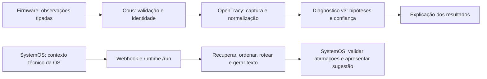

# Cognição no SystemOS, Cous e OpenTracy

Auditoria iniciada em 15/10/2026 e atualizada em 16/10/2026, horário de São Paulo. A inspeção incluiu o SystemOS no Windows e os projetos OpenTracy e Cous no Linux. **O SystemOS agora publica um snapshot técnico identificado e consulta o diagnóstico v3 antes da redação.** As etapas abaixo distinguem os problemas encontrados, as correções implantadas e os limites restantes. A integração não certifica a qualidade do diagnóstico nem resolve, por si, a redação do modelo.

## Arquitetura prevista e caminho observado

A referência principal é `OpenTracy/docs/INTEGRACAO_FIRMWARE_COUS_COGNICAO.md`, confrontada com o código, não tomada como prova de implementação. O Cous descreve sua divisão de responsabilidades em `README.md` e `docs/ARQUITETURA.md`.



Na auditoria inicial de 15/10, o SystemOS usava somente a linha inferior. A Etapa 3 documenta o caminho novo. Estar conectado ao OpenTracy não implica, por si, utilizar seu motor de diagnóstico.

| Responsável | Contrato previsto | Situação na auditoria inicial |
| --- | --- | --- |
| Firmware | Medir, qualificar e publicar observações/correlações. | Fonte de medições, não redator de laudos. |
| Cous | Resolver equipamento/OS, normalizar evidências e vincular captura. | Clientes próprios de medições e diagnóstico v3 existem. |
| OpenTracy | Preservar captura, derivar assinatura, avaliar hipóteses e explicar resultados fundamentados. | Serviços de captura e diagnóstico disponíveis; cobertura de domínio ainda limitada. |
| SystemOS | Preservar fatos da OS e autoria, solicitar apoio, revisar e aplicar explicitamente. | Envia contexto técnico ao webhook; não foi encontrada ligação deste recurso com a fila v3. |
| Modelo de linguagem | Explicar resultados e registros, sem fabricar medições ou transformar possibilidade em constatação. | Houve respostas com unidades e afirmações incompatíveis com a OS, corretamente recusadas pela validação. |

Os clientes do Cous estão em `cous/clients/diagnosis.py` e `cous/clients/measurements.py`. Os contratos canônicos incluem `/measurements/sessions/{id}/snapshots`, `/v3/operational/resolve-capture`, `/measurements/sessions/{id}/capture-link` e `/v3/diagnosis`. A solicitação v3 exige `correlation_id`, `capture_session_id`, `instance_id`, `domain_id`, `callback_endpoint`, `priority`, `evidence_set` e `context`. Não se deve preencher essas identidades com UUIDs arbitrários apenas para satisfazer o esquema.

## Evidências da auditoria

| Verificação | Resultado observado | Limite da conclusão |
| --- | --- | --- |
| Diagnóstico v3 | Habilitado, banco configurado e worker em execução. | Disponibilidade não demonstra qualidade nem uso pelo SystemOS. |
| Capturas | Backend PostgreSQL e autenticação configurados. | Não demonstra vínculo correto de todas as OS atuais. |
| Base de conhecimento | 169 documentos e 676 trechos. | Quantidade não demonstra pertinência ou validação técnica. |
| Histórico de captura | 51 sessões de medição e 16 capturas. | Contagem do momento da auditoria, não contrato fixo. |
| Fila de diagnóstico | 33 concluídos; último enfileiramento observado em 28/09. | As análises atuais do SystemOS não aparecem como novos diagnósticos v3. |
| Conhecimento consolidado | 7 unidades ativas confirmadas; 6 ligadas a modos catalogados e uma unidade genérica de teste. | A unidade genérica é filtrada pelo worker; deve ser retirada da base operacional por procedimento separado. |
| Modos determinísticos | Rotor bloqueado, desacoplamento, sobrecarga nominal, sobretensão, interrupção e queda da fonte. | Não cobrem todo o domínio de reparação, contaminação ou danos de baterias. |
| Confiança | Combinação heurística de evidência, documentos, histórico e consistência. | Não é probabilidade de acerto calibrada em casos reais. |

A tabela `hypotheses` vazia não foi usada como prova de ausência de resultados: o worker também persiste resultados na fila. Dados privados, conteúdo integral das OS, credenciais e strings de conexão não fazem parte desta documentação.

### Geração de texto

Em `techniques/prompt_strategies/impl.py`, a variante direta seleciona constantes de prompt para SystemOS e para os demais pedidos. Nesse caminho, o prompt configurado em `agent/prompts/system.md` não é o que governa a chamada. Alterar somente esse Markdown pode não alterar o comportamento observado.

O caminho Ollama não executa o ciclo de ferramentas disponível no caminho OpenAI/DeepSeek. Descobrir ferramentas no código não significa fornecê-las ao modelo ou executar suas chamadas. A mensagem SystemOS também limita o material recuperado ao primeiro documento e a 600 caracteres. Esses pontos continuam pendentes.

O roteamento configurado usa `qwen3.5:4b` nos dois níveis, sem escalonamento em falha. O modelo roda no Windows, acessado pelo Linux através do túnel. Não foi substituído pelo modelo de 0,8b do Linux. `think: false` é a configuração observada; não foi alterada nesta etapa.

### Busca de conhecimento

O limite anterior era de cinco segundos. Uma consulta direta de domínio levou 13,07 segundos e retornou cinco documentos. O trace `386f2902-6e9d-469c-9f7d-477635c6f1f0` apresentou zero documentos na recuperação e no rerank; o log registrou timeout. A etapa devolvia lista vazia sem marcar erro no registro da etapa, confundindo indisponibilidade com ausência de resultados.

A consulta de verificação após a correção, usando os knobs do agente e sem chamar o modelo, recuperou **20 trechos em 11,04 segundos**. É uma amostra funcional; não representa latência máxima ou garantia de cobertura de todas as OS.

### Avaliações existentes

A suíte smoke encontrada era de atendimento de comércio eletrônico, com limite de quatro segundos. Foram encontrados 26 goldens na raiz; o caso de medição DKLAB não possui expectativas de conteúdo capazes de certificar uma conclusão técnica. Não há demonstração, nessa suíte, de calibração do diagnóstico de assistência técnica. Testes de infraestrutura e schema não substituem casos revisados por especialista.

## Correções implementadas nesta etapa

| Arquivo OpenTracy | Correção | Verificação |
| --- | --- | --- |
| `runtime/diagnosis/worker.py` | Não produzir hipótese sem evidência válida além do contexto administrativo; ignorar evidência marcada inválida. | Casos vazios, somente contexto, somente referência e somente conhecimento não geram diagnóstico. |
| `runtime/diagnosis/worker.py` | Aplicar `can_be_primary_hypothesis`, inclusive nos caminhos genérico e de telemetria. | Confianças 0,56 e 0,60 não são promovidas a hipótese primária; limiar comum é 0,61. |
| `runtime/diagnosis/worker.py` | Exigir presença de métricas observadas reconhecidas antes do fallback de telemetria. | Referências nominais isoladas não são apresentadas como funcionamento normal observado. |
| `techniques/rag/impl.py` e `agent/pipeline/retrieve.yaml` | Limite de busca de 45 segundos; estado explícito de recuperação. | Busca real concluída e testes de timeout/erro/resultado. |
| `runtime/executor/pipeline.py` | Copiar somente `status`, `reason` e `documents` da recuperação para `ExecutionRecord.metadata`. | Serialização preserva o estado sem copiar campos privados arbitrários do contexto. |
| Testes do worker, RAG e executor | Regressões para os casos acima. | 63 testes aprovados na seleção descrita abaixo. |

Antes da correção, a chamada sem evidências podia gerar “operação normal”, confiança 0,56 e `is_primary: true`. O caminho genérico também podia promover a primeira hipótese abaixo do limiar. Agora, ausência de observações não gera hipótese e candidatos fracos permanecem não primários.

**Limite ainda existente:** reconhecer a presença de um campo não equivale a qualificar a suficiência de uma coleta inteira. O fallback ainda pode produzir um candidato fraco de normalidade a partir de observações parciais. É necessário definir quais canais, qualidade e condições de ensaio sustentam cada conclusão. Zero medido, canal não medido e dado inválido precisam permanecer distintos.

A recuperação registra:

- `ok`: busca concluída com documentos;
- `empty`: busca concluída sem documentos;
- `unavailable` com motivo `not_configured`, `timeout` ou `search_error`.

A execução ainda pode continuar sem recuperação. Esta etapa não cria uma política de bloqueio automático da geração, nem muda `success` para falha quando apenas a busca falha. O diagnóstico de disponibilidade fica nos metadados; a API do gateway não ganhou um contrato novo de diagnóstico.

## Comportamento atual preservado no SystemOS

As funções ficam em `apps/api/src/assistente-ia/assistente-ia.service.ts`; o tipo de origem fica em `assistente-ia.types.ts`.

- O contexto técnico inclui componentes, testes de bancada, checklist, medições/correlações TDMA, serviços e metadados de anexos. Metadados não equivalem à leitura de fotografias ou PDFs.
- Nomes e contatos do cliente não são enviados; equipamento e série podem integrar o contexto técnico.
- A geração é assíncrona, com consulta de andamento, limite de 900 segundos e resultado temporário vinculado ao escopo de acesso.
- A validação rejeita afirmações sem apoio, incluindo números e unidades incompatíveis. Não foi afrouxada para fazer uma resposta ruim aparecer como válida.
- Quando toda a conclusão gerada é rejeitada, `textoBaseDosRegistros` compõe um texto com testes e análises registrados. Sua origem é `REGISTROS_OS`, distinta de `OPENTRACY`. Isso é contingência, não uma inferência bem-sucedida do modelo.
- `concluirComServicosSugeridos` acrescenta serviços já registrados, com confirmação de conformidade condicionada à execução e à verificação. Não deve afirmar que uma recomendação foi executada.
- A lista de IDs de evidência saiu da apresentação da conclusão; a rastreabilidade interna continua necessária.
- A sugestão não é aplicada automaticamente à OS. Rejeição parcial ainda exige revisão e pode deixar texto incompleto.

Esses comportamentos já existiam antes desta etapa. O commit de referência do SystemOS é `5b9f7d0`. Nenhum código de produto do SystemOS foi modificado nesta etapa de auditoria e documentação.

## Dimensionamento: contexto e tempo

16.384 tokens é o limite configurado de contexto, não uma medida de velocidade. Instruções, evidências recuperadas, conteúdo da OS e resposta precisam dividir esse orçamento; não se deve ocupar todo o limite com a entrada. O tamanho em bytes do JSON não é uma contagem exata de tokens.

Medições anteriores do mesmo ambiente, com aproximadamente seis mil tokens de entrada e algumas centenas de saída, levaram **8min29s e 9min19s**. São amostras históricas, não previsão por OS. A busca de 11 segundos não mede a geração. Particionar o conteúdo aumenta o número de chamadas e pode repetir processamento de contexto; não garante redução do tempo total.

Para dimensionar de modo reproduzível, registrar por fase: modelo/digest, configuração, tokens de entrada/saída, tempo de carga, avaliação de entrada, geração, busca, fila e duração total. Separar execução fria de quente e carga concorrente. Usar o tokenizer do modelo ou a contagem efetiva do servidor. Comparar um resumo tipado completo com lotes por subsistema e síntese final, sempre sobre os mesmos casos revisados. Não foram executados novos ensaios longos do modelo nesta etapa.

## Validação e ativação

No Linux, a partir do diretório do OpenTracy:

```bash
.venv/bin/python -m pytest runtime/tests/test_electromechanical_diagnosis.py runtime/tests/test_diagnosis_worker.py runtime/tests/test_cous_facts_tools.py knowledge/tests/test_causal_engine_modes.py techniques/rag/tests/test_dense.py runtime/tests/test_retrieval_observability.py runtime/tests/test_per_agent_executor.py -q
```

Resultado: **63 aprovados em 0,96 segundo**. São testes de lógica e infraestrutura, sem novas inferências do modelo e sem alterar uma OS real. A seleção inclui os casos novos e regressões do motor, ferramentas e cache do executor.

O runtime foi reiniciado de forma controlada: PID anterior conferido por diretório de trabalho e comando, encerramento por SIGTERM e início de uma única instância. Após a ativação: runtime `/health` respondeu `ok`, agente `v0.0.8`; gateway `/health` respondeu `ok`; diagnóstico v3 respondeu `available` com worker ativo. PID após a operação: `2646675` — valor histórico; não reutilizar em comandos sem verificar o processo atual.

A consulta real de busca passou com 20 trechos e `retrieval.status=ok`. Ela não gerou um novo diagnóstico nem uma nova conclusão. Gateway, banco, arquivos, túnel e Ollama não foram reiniciados. A versão nominal do agente não mudou; identificar esta correção pelo conjunto de arquivos/patch e pelos testes, não apenas por `v0.0.8`.

## Backup e reversão

Backup anterior às alterações desta etapa:

`/home/hiatus/.local/state/opentracy-systemos/backup-cognicao-20261015-232142`

O backup preserva as versões imediatamente anteriores, inclusive alterações locais que já existiam. `manifest.json` contém hashes SHA-256. O repositório Linux já tinha alterações não commitadas; não foi feito reset nem limpeza dessas alterações. O patch desta etapa deve ser comparado com esse backup, não com todo o diff do repositório.

Para reverter: verificar a identidade do runtime atual pelo PID registrado em `~/.local/state/opentracy-systemos/runtime.pid` e por `/proc/<pid>/cwd` e `/proc/<pid>/cmdline`; encerrar apenas esse runtime; validar os hashes do backup; restaurar os seis arquivos de código, testes e configuração existentes copiados no backup. O README também possui cópia anterior para reverter o link de documentação, se necessário. O teste novo `runtime/tests/test_retrieval_observability.py` não existia antes: removê-lo apenas se continuar sendo exatamente o arquivo introduzido por esta etapa. Não restaurar o repositório inteiro.

Reiniciar no diretório do OpenTracy com a mesma configuração de execução:

```bash
export OPENTRACY_OLLAMA_URL=http://127.0.0.1:11436
export OPENTRACY_OLLAMA_CONTEXT_WINDOW=16384
export OPENTRACY_OLLAMA_TIMEOUT_SECONDS=900
export OPENTRACY_OLLAMA_JSON=true
.venv/bin/python -m runtime.server
```

Manter esse terminal aberto se executado em primeiro plano. Para operação desacoplada, preservar o mecanismo gerenciado com PID e log; não iniciar uma segunda instância na porta ocupada. Verificar os mesmos endpoints de saúde. Não encerrar o túnel ou subir um Ollama diferente para contornar a falha.

## Próximas etapas e critérios de aceite

1. **Formalizar o adaptador SystemOS para o contrato existente.** Resolver identidades reais e vínculos organização/OS/equipamento/captura; normalizar evidências e unidades; vincular captura; solicitar diagnóstico v3. Definir autenticação, callback permitido, correlação, idempotência, repetição e consulta de estado. Não criar uma rota paralela que contorne essas etapas.
2. **Qualificar observações por hipótese.** Definir canais mínimos, qualidade, condições de operação e interpretação de zero/ausente/inválido. Recusar afirmação de normalidade quando a coleta não a sustenta.
3. **Separar diagnóstico de redação.** Fornecer ao modelo os fatos, hipóteses qualificadas e serviços propostos. Preservar limitações e incerteza; não permitir recalcular valores, inventar causalidade ou alterar a confiança formal.
4. **Corrigir o contrato efetivo de prompts e ferramentas.** Um caminho verificável para o prompt configurado e, se necessário, ciclo real de ferramentas somente leitura no provedor Ollama. Testar que o prompt e os resultados das ferramentas chegam ao modelo.
5. **Montar avaliações de domínio com revisão técnica.** Aprovar fixtures e conclusões esperadas antes de medir qualidade. Avaliar cobertura, contradições, causalidade indevida, unidades, completude, serviços sugeridos e abstenção; usar latência apenas junto da qualidade.
6. **Integrar e liberar com rastreabilidade.** Testar isolamento entre organizações, callback forjado, captura de outra OS, resposta atrasada, duplicidade, indisponibilidade e cancelamento. Só depois validar uma OS real em modo de sugestão, mantendo a decisão técnica humana.

| Caso de aceite | Resultado necessário | Estado nesta etapa |
| --- | --- | --- |
| Sem observações ou apenas contexto/referência | Nenhum diagnóstico de normalidade. | Automatizado. |
| Evidência inválida | Não sustenta hipótese. | Automatizado. |
| Confiança abaixo de 0,61 | Não primária. | Automatizado nos caminhos corrigidos. |
| Timeout de busca vs zero documentos | Estados distintos e preservados no trace. | Automatizado; busca real também verificada. |
| OS 1138: desacoplamento e inicial manual sem canais mensuráveis | Preservar limitação inicial; não inventar RPM/frequência; distinguir pós-reparo. | Precisa de fixture completa e validação técnica. |
| OS 1141: contaminação, películas, lubrificante e escovas | Cobrir fatos sem afirmar fratura ou dano funcional não constatado; separar possibilidade e constatação. | Precisa de fixture completa e validação técnica. |
| Serviços sugeridos | Baseados nos registros; não apresentados como executados. | Há montagem determinística no SystemOS; avaliar junto do novo diagnóstico. |
| Valor com unidade inventada | Rejeitar, sem flexibilizar a evidência. | Proteção existente no SystemOS; incluir na suíte integrada. |
| Callback/captura de outro escopo | Recusar sem alterar OS. | Integração canônica ainda pendente. |

## Fontes e artefatos

No Linux: projetos `/home/hiatus/Projetos/ligadotattoo/OpenTracy` e `/home/hiatus/Projetos/ligadotattoo/ligadoAi_cous_opentracy`. Fontes inspecionadas: documentos de arquitetura citados, `runtime/diagnosis/worker.py`, `knowledge/domain/confidence.py`, `techniques/rag/impl.py`, `techniques/prompt_strategies/impl.py`, `runtime/executor/pipeline.py`, configurações de pipeline e suítes de avaliação.

No SystemOS, `.runtime/auditoria-cognicao-linux/` conserva snapshots anteriores à correção, o reproducer e resultados da auditoria. Esses arquivos são privados e ignorados pelo Git. No Linux, `~/.local/state/opentracy-systemos/validacao-cognicao-20261015.json` registra a busca real; `runtime.log` e `runtime.pid` registram a instância gerenciada. O patch `correcao-cognicao.patch` e os hashes `arquivos-apos.json` desta etapa ficam ao lado do backup. Sua aplicação reversa foi conferida com `git apply --reverse --check`, sem modificar arquivos. O HEAD inspecionado do OpenTracy era `cb66c72`; as correções Linux permanecem no diretório de trabalho, preservadas pelo patch, sem misturar em um commit as alterações anteriores à auditoria. Não versionar logs integrais ou respostas com dados de clientes.

## Etapa 2 — identidade canônica e repetição de pedidos

Continuação em 15/10/2026. Implementação Linux commitada em `9e7c157` (`fix: validate scoped service orders and diagnosis request identity`). Não foram criadas rotas paralelas: os acréscimos estão em `/v3/operational/resolve-capture` e `/v3/diagnosis`.

### Contrato de vínculo com a OS

As duas solicitações aceitam `service_order_scope` opcional, com três campos obrigatórios quando o objeto está presente:

| Campo | Tipo e origem |
| --- | --- |
| `source_system` | Literal `systemos`. |
| `organization_id` | UUID real da organização autenticada no SystemOS. |
| `service_order_id` | UUID real da OS autorizada nessa organização. |

Objeto incompleto, UUID inválido, origem desconhecida e campos extras são recusados pelo schema. O adaptador futuro deve obter esses valores do contexto autorizado do servidor, não confiar em valores livres do navegador.

O resolver agora exige correspondência dos três campos em `knowledge_documents.metadata.extra`, além da OS, domínio e série. Quando o escopo é informado e não existe documento correspondente, ele não recua para uma busca apenas pelo número. Documentos excluídos também são ignorados. A série continua sendo conferida. O contrato sem escopo permanece aceito para compatibilidade com o Cous existente; isso não equivale a isolamento completo por organização no OpenTracy. O Bearer da aplicação continua sendo necessário quando configurado.

### Integridade e idempotência do diagnóstico

Antes de enfileirar, o endpoint verifica se a captura pertence à instância e ao domínio declarados. Se houver escopo, confere também se o documento de OS vinculado à captura corresponde aos três campos. Incompatibilidade retorna HTTP 409 sem inserir pedido.

A repetição de um `correlation_id` com a mesma solicitação devolve o estado e a data originais, inclusive quando o pedido já terminou. Não cria outro pedido nem o apresenta novamente como recém-enfileirado. Reutilizar o identificador com captura, contexto, evidências, callback ou outro campo diferente retorna 409. O resultado existente permanece intacto.

A resolução de identidade ainda cria um evento novo de captura por chamada. A integração SystemOS precisará persistir e reutilizar o vínculo antes de repetir a resolução; a idempotência da fila não elimina essa obrigação. O escopo conferido no documento também não substitui autorização do cliente integrador ou validação/autenticação do callback.

### Verificação desta etapa

Foram executados **85 testes, aprovados em 1,39 segundo**, reunindo a seleção anterior e os contratos novos. O teste PostgreSQL usa uma conexão dedicada, `search_path` restrito a `pg_temp` e tabelas temporárias. Não consulta nem altera registros de clientes para simular o fluxo.

O teste cria duas organizações com o mesmo número de OS e verifica: resolução do documento correto, recusa de organização/ID de OS/série divergentes, ausência de captura adicional nas recusas, recusa de captura/instância/domínio incorretos, recusa de documento excluído e repetição idempotente de diagnóstico. O teste HTTP também verifica o Bearer inválido e a rejeição de reutilização do identificador com conteúdo diferente.

Teste adicional: `runtime/tests/test_operational_scope_postgres.py`. Ele exige `OPENTRACY_RUN_DB_TESTS=1` e a configuração privada `OPENTRACY_KNOWLEDGE_DATABASE_URL`. Sem a opção explícita, é ignorado. A configuração privada foi carregada no processo de teste, sem imprimir seu conteúdo.

Após os testes, somente o runtime foi reiniciado. O OpenAPI carregado confirmou `service_order_scope` nos dois schemas. Runtime e gateway responderam `ok`, e o worker de diagnóstico respondeu `available`. PID observado após esta ativação: `2654330`; consultar e validar o PID atual antes de qualquer operação futura. A versão nominal permanece `v0.0.8`.

### Condição encontrada na base operacional

Consulta somente leitura: **85 documentos ativos de OS, nenhum com os três campos de escopo**. A busca pelo campo `metadata.extra.service_order_number` também não encontrou 1138 ou 1141. Isso não prova que não exista texto antigo dessas ordens em outro formato; prova que não há correspondência estruturada suficiente para ativar com segurança o novo caminho para elas.

Nenhum documento antigo foi associado automaticamente a uma organização e nenhum ID de captura foi inventado. O botão de análise do SystemOS continua no fluxo anterior. Esta etapa prepara e verifica o contrato canônico, mas **ainda não conecta a geração de conclusão ao diagnóstico v3** e não demonstra melhora da redação.

### Próximo incremento do adaptador

Implementar a publicação de um snapshot técnico identificado da OS pelo servidor do SystemOS, com autorização e revisão de escopo. A indexação deverá preservar `source_system`, `organization_id`, `service_order_id`, número da OS, série e versão/hash do snapshot. Reconciliar documentos antigos somente quando existir correspondência verificável; não presumir que número de OS identifica uma organização.

Em seguida, persistir a associação com os IDs retornados pelo resolver; importar/vincular apenas medições realmente existentes, com suas condições e qualidade; solicitar diagnóstico com correlação persistida; consultar/receber resultado verificando novamente a captura e o escopo. Só depois usar esse resultado e os registros técnicos como entrada da redação. O fluxo antigo não deve ser desativado antes dessa verificação de ponta a ponta.

### Preservação e reversão

Backup desta etapa: `/home/hiatus/.local/state/opentracy-systemos/backup-identidade-20261015-233809`. Contém os seis arquivos preexistentes, `manifest.json`, `identidade-escopo.patch` e `arquivos-apos.json`. O sétimo arquivo é o teste PostgreSQL novo. Antes de editar, foi conferido que os seis arquivos eram iguais ao HEAD; o commit não incluiu alterações anteriores de outros arquivos do Linux.

A reversão do patch passou em `git apply --reverse --check`. Para executar uma reversão futura, conferir novamente essa checagem no diretório do OpenTracy e a identidade do runtime, interromper somente esse processo, aplicar a reversão apenas se a checagem continuar válida e reiniciar com a configuração preservada. Não usar reset do repositório. Gateway, túnel, Ollama e dados operacionais permanecem preservados. A reversão não exige migração de banco: os acréscimos usam metadados e colunas já existentes.

## Etapa 3 — snapshot da OS e consulta do diagnóstico v3

Implementação entre a noite de 15/10 e a madrugada de 16/10/2026. Código SystemOS: `ad694c9`; código OpenTracy: `4ec988f`, com proteção adicional de metadados reservados em `698fcf1`. Esta etapa substitui a condição de integração ainda ausente descrita nas etapas anteriores. A avaliação de qualidade da redação continua pendente.

### Caminho implementado

```mermaid
sequenceDiagram
  participant S as SystemOS autorizado
  participant G as Gateway Linux
  participant O as OpenTracy
  S->>S: Carregar OS no escopo; preparar snapshot e hash
  S->>G: POST /knowledge/index (snapshot inline)
  G->>O: Contrato canônico autenticado
  S->>G: GET /knowledge/jobs/{id}
  S->>G: POST /v3/operational/resolve-capture
  Note over S,O: Escopo + documento exato + pedido persistido
  S->>G: POST /v3/diagnosis (delivery_mode=polling)
  S->>G: GET /v3/diagnosis/{correlation_id}
  S->>S: Conferir correlação, captura, escopo e hash
  S->>G: Fluxo existente de redação com diagnóstico de apoio
  S->>S: Validar frases nas evidências originais; apresentar sugestão
```

O botão existente continua iniciando um trabalho assíncrono. Com `AI_OPENTRACY_COGNITIVE_ENABLED=true`, a API consulta primeiro o diagnóstico canônico e só depois solicita a redação. Uma falha cognitiva interrompe esse pedido; não há desvio silencioso para a redação isolada. A aplicação da sugestão à OS continua explícita e separada.

### Conteúdo, versão e privacidade

`diagnostico-cognitivo.service.ts` prepara/publica o snapshot com versão de schema, organização, ID da OS, número da ordem, fabricante, modelo, série, evidências técnicas e ensaios. A identificação nominal do cliente não é copiada. Isso não elimina a necessidade de cuidado com dados pessoais eventualmente digitados dentro de textos livres pelo operador.

A serialização canônica preserva datas e zeros, ordena as chaves e produz SHA-256. O endereço lógico é `systemos://<organizacao>/<ordem>/<hash>`, usado como identidade do documento, não como URL a ser baixada. O runtime verifica hash, URI, escopo e a correspondência do corpo JSON com o número da OS e a série declarados. Snapshot acima de 128 KiB é recusado sem truncamento.

O snapshot entra pela rota `/knowledge/index`, que ganhou suporte inline restrito a esse contrato. Ele é registrado com trechos para rastreabilidade, **sem embeddings e com `retrieval_eligible=false`**. Não entra na recuperação semântica, lexical ou no catálogo textual do RAG. Isso evita transformar uma OS particular em conhecimento geral para a redação de outras OS. A API operacional autenticada de documentos continua sendo uma superfície administrativa: essa proteção não implementa, sozinha, autorização multi-organização para todo o OpenTracy.

A captura é vinculada ao ID exato do documento, não ao documento mais recente que tenha o mesmo número. `capture_request_id` permite repetir a resolução sem criar uma segunda captura. O UUID da captura é derivado pelo servidor para idempotência e corresponde a uma linha real criada pelo resolver; não é um identificador preenchido sem registro correspondente.

### Persistência e repetição

Migração SystemOS `048_diagnostico_cognitivo.sql`: tabela `diagnosticos_cognitivos_os`, com FK composta para organização/OS e unicidade por organização, OS e hash. Guarda snapshot, correlação, progresso dos vínculos externos e resultado validado. Um bloqueio de sessão serializa pedidos concorrentes do mesmo snapshot sem manter uma transação aberta durante chamadas HTTP.

Job, documento, captura e resultado são persistidos por etapa. Repetição do mesmo conteúdo reaproveita o vínculo e o resultado. Alteração dos dados produz outro hash e outro diagnóstico. Falha de publicação libera o job para uma nova tentativa; diagnóstico que falhou pode ser reenfileirado pela rota canônica de retry, sem substituir sua identidade ou suas evidências.

`delivery_mode=polling` acrescenta consulta autenticada como modalidade explícita do contrato de diagnóstico. Não configura callback. O worker grava `callback_status=not_required`; a migração de manutenção do outbox preserva esse estado. O contrato antigo de callback permanece o padrão para o Cous.

### Transporte e credenciais

O gateway na porta 8002 ganhou encaminhamento somente para uma lista de métodos/caminhos canônicos: publicação e consulta do job, resolução de captura, diagnóstico, consulta por correlação e retry. Não há proxy arbitrário de URL, leitura geral de documentos ou exposição do runtime na rede.

O SystemOS usa `AI_OPENTRACY_COGNITIVE_TOKEN`; o gateway valida `SYSTEMOS_COGNITIVE_TOKEN` e usa a credencial correspondente do runtime em loopback. Os valores estão somente nos arquivos privados de ambiente; não foram incluídos em código, documentação, saída dos testes ou variáveis públicas do navegador. O recurso permanece desabilitado por padrão em `.env.example` e foi habilitado no ambiente operacional após a validação do caminho real.

### Medições e limites do motor

A evidência de contexto conserva os registros técnicos completos. Para o motor numérico, este incremento envia apenas resumos observados da coleção mais recente, separados por fonte, com unidade esperada e contagem de amostras. Não mistura coleções, não trata referência nominal como medição e não converte grandeza desconhecida para zero. Zero efetivamente registrado permanece zero.

Medição manual sem curva permanece no contexto técnico; não é fabricado um frame de sensor ou um canal ausente. A coleta escolhida informa sua fase, mas este incremento ainda não fornece ao motor a comparação causal completa entre inicial e pós-reparo. Ele também não reimporta todos os frames/correlações do firmware nem substitui a sincronização de medições do Cous. A qualificação de condições, canais mínimos e cobertura temporal permanece uma próxima etapa.

As hipóteses retornadas entram como apoio à redação e não como novas evidências de inspeção. O prompt distingue candidato de hipótese primária e mantém a obrigação de apoiar cada frase nos registros originais. A confiança formal não substitui a autoavaliação do redator. O resultado não aprova equipamento nem comprova execução de serviço.

### Verificações

- Linux: **114 testes aprovados**, incluindo schema, indexação, RAG, motor, contratos, idempotência e PostgreSQL temporário.
- Gateway: checagem de tipos e teste de autenticação, rotas permitidas e limite de corpo aprovados.
- SystemOS: checagem de tipos e **cinco testes do adaptador aprovados**, incluindo PostgreSQL com tabelas temporárias, ordem das chamadas antes da redação, recusa de resultado de outra captura, reutilização e recuperação de falhas.
- Teste real somente do caminho cognitivo na OS 1141: 25 evidências, um ensaio, aproximadamente **7,8 segundos**; repetição em aproximadamente **0,1 segundo**, com a mesma captura/correlação. Retornou um candidato e nenhuma hipótese primária.
- Conferência no banco do Linux: pedido concluído, `callback_status=not_required`, zero tentativas de callback, dois trechos operacionais e zero embeddings para o snapshot.

Esse teste real não chamou o modelo de redação e não aplicou conclusão à OS. Seu tempo mede publicação, identidade, fila e regras do diagnóstico; não mede a duração total de uma nova redação. Os testes automatizados de sequência usaram resposta simulada para o redator. Ainda é necessário avaliar a redação real em casos revisados por especialista, incluindo a OS 1138 e a OS 1141.

Os artefatos privados de verificação ficam em `.runtime/validar-cognicao-real.cjs` e `.runtime/validacao-cognicao-real-1141.json`. O snapshot e o resultado da conferência real ficam na tabela privada da integração; não foram publicados no portal do cliente.

### Operação e reversão desta etapa

A migração 048 foi aplicada antes da ativação e cria somente a nova tabela. Os serviços Linux foram reiniciados com verificação de processo; runtime e gateway responderam `ok`. Banco, arquivos, túnel SSH, Ollama e dados de atendimento foram preservados. Os PIDs históricos constam nos arquivos gerenciados em `~/.local/state/opentracy-systemos/`; sempre verificar a identidade atual antes de parar processos.

Para suspender a etapa cognitiva e voltar ao fluxo anterior de redação, alterar somente `AI_OPENTRACY_COGNITIVE_ENABLED=false` no ambiente privado e reiniciar a aplicação pelo `sisweb`. Com o build atual válido, `-SemBuild -SemDependencias -Reiniciar` recarrega a configuração sem recompilar. Preservar a tabela e seus registros de rastreabilidade; não apagar diagnósticos para reverter a interface. As extensões Linux mantêm compatibilidade com os contratos anteriores.

Backup Linux anterior a esta etapa: `~/.local/state/opentracy-systemos/backup-snapshot-20261015-234911`, com cópias, patch e hashes. O commit incluiu somente alterações desta etapa; diferenças anteriores nos mesmos arquivos foram preservadas fora do commit por seleção de hunks. Para reversão de código, comparar com o backup e o commit específico; não usar reset nem descartar o diretório de trabalho. O ambiente privado também possui cópias anteriores à instalação da credencial.


### Resultado da implantação no SystemOS

Build operacional confirmado: `aab93df4-9c38-47d8-afef-d0c3e6f2d172`. O `sisweb` conferiu API, web e portal pelo domínio público após reiniciar somente API/web. A flag cognitiva está habilitada no ambiente privado; a credencial permaneceu fora do Git.

Regressão SystemOS: 114 testes aprovados e um caso opcional de banco ignorado na suíte unitária; os cinco testes do adaptador, incluindo esse caso com PostgreSQL temporário, passaram em execução específica. A integração completa passou em 196 testes, incluindo migrações, escopos, armazenamento, documentos e recuperação. A stack `systemos-tests` foi criada com dados em tmpfs e removida ao final; usou somente o binário da imagem local de MinIO em instância separada, sem compartilhar volumes operacionais.

A validação da etapa está concluída para publicação, identidade, regras existentes, persistência e consulta do diagnóstico. Permanecem pendentes os incrementos de cobertura física/temporal, o contrato de prompts/ferramentas e a avaliação especializada da redação real. Nenhuma conclusão da OS 1141 foi gerada ou aplicada nesta conferência real.

## Correção de autenticação da redação — 16/10/2026

Após a ativação, uma tentativa real da OS 1141 concluiu publicação, resolução e diagnóstico v3, mas falhou antes de chegar ao redator. O gateway registrou `POST /v1/webhook` com HTTP 401. A API do SystemOS apresentava a mensagem genérica porque esse erro não tinha classificação conhecida.

Causa: o reinício do gateway carregou `BACKEND_API_KEYS` do ambiente persistente, ativando a autenticação também no webhook existente. A chamada de redação do SystemOS ainda não enviava Bearer. O caminho cognitivo usa uma credencial própria e funcionou; disponibilidade do diagnóstico e dos endpoints de saúde não comprovava autenticação da redação. O teste anterior de publicação/diagnóstico não exercitava esse trecho final.

Correção `0ba54b9`: a chamada de redação envia `AI_OPENTRACY_API_KEY` como Bearer, com valor privado aceito pelo gateway. A autenticação não foi removida. Respostas 401/403 agora têm classificação e mensagem explícitas na análise assíncrona; o log registra tipo e status sem divulgar a credencial ou a mensagem arbitrária do provedor. A configuração de exemplo contém somente o nome da variável, sem o segredo.

Verificações anteriores à implantação: seis testes do adaptador passaram, incluindo o envio do header, recusa de credencial, mensagem da tarefa assíncrona e PostgreSQL temporário. Na conferência real do gateway, o mesmo pedido vazio retornou 401 sem autenticação e 400 com autenticação: este último passou pelo middleware e foi recusado pelo schema, sem executar o modelo. Uma análise real completa foi iniciada separadamente para validar também a chegada ao redator; seu resultado será registrado abaixo.


Implantação da correção: build `4198e9b0-038a-4d6f-8307-66126230a70d`, confirmado pelo `sisweb -Status` no domínio público. A suíte unitária passou em 115 testes, com um teste opcional ignorado; o conjunto específico do adaptador passou em seis testes com PostgreSQL temporário habilitado. O resultado da análise real completa permanece em validação neste ponto do registro.


Resultado final da validação real: a chamada concluiu com autenticação aceita, trace `f93d3a96-1c05-455e-97bd-acba0ea6c16c`, em 626.934 ms (aproximadamente 10min27s). A busca recuperou documentos, e o redator consumiu 7.371 tokens de entrada e produziu 381 de saída. Não houve estouro comprovado do contexto de 16 mil tokens nessa execução.

A resposta do modelo foi rejeitada pela validação factual. Ela incluiu valores numéricos sem citar a evidência de medição correspondente, afirmou tensão nominal e descartou anomalias além do que os registros sustentavam; um parágrafo também terminou incompleto. O sistema devolveu 1.293 caracteres de texto-base, com origem `REGISTROS_OS` e alerta de revisão, em vez de aceitar a redação inadequada. Isso confirma a correção do erro 401 e a chegada ao modelo, mas não comprova qualidade de redação do OpenTracy. Nenhum texto foi aplicado à OS. O resultado e o trace integral foram preservados em arquivos privados de `.runtime` para a próxima etapa de avaliação, sem versionar dados da ordem.


## Contrato de redação e parágrafos completos — 16/10/2026

A execução anterior expôs um limite de 700 caracteres tanto no schema enviado ao Ollama quanto na validação da API. O modelo produziu um parágrafo encerrado no meio de uma palavra; a API também podia truncar silenciosamente um texto recebido. O teto agora é de 1.800 caracteres por parágrafo, com orientação para frases curtas e completas. A API rejeita parágrafos acima do teto em vez de recortá-los. Essa alteração não reduz os critérios de apoio factual, unidades ou referências.

O OpenTracy passou a carregar um contrato específico em `agent/prompts/systemos-conclusao.md`, configurável pelo knob `systemos_prompt`. O texto distingue funcionamento registrado nos testes, inspeções, efeitos potenciais, hipóteses e propostas. A redação não deve recalcular valores das tabelas nem usar critérios/referências TDMA como comprovação de estabilidade elétrica ou exclusão de causas. O snapshot completo e o diagnóstico v3 permanecem no fluxo; este ajuste não amplia a cobertura física do motor de regras.

A detecção de pedidos de inventário examinava também as instruções da tarefa: expressões como “todos os componentes” podiam acrescentar o catálogo global ao contexto. Tarefas identificadas como análise SystemOS agora não acionam essa busca de inventário. Como defesa adicional, o renderizador não seleciona o catálogo como trecho técnico de apoio. A consulta comum de inventários do Cous continua atendida. Isso não comprova relevância de todo documento recuperado; a pertinência do RAG permanece um item de avaliação.

O resultado dos serviços sugeridos continua sendo composto a partir dos registros da OS, sem declarar execução ou conformidade final. Os IDs das evidências continuam disponíveis para rastreabilidade interna, sem virar uma lista no texto da conclusão. Não foi relaxada a validação para aceitar o texto inadequado do teste anterior.

Verificações iniciais: 28 testes da revisão técnica passaram com compilação isolada da API; 22 testes Linux passaram nos conjuntos de prompt e recuperação. Incluem carregamento efetivo do prompt pela técnica, preservação do contexto da OS, exclusão de catálogo e rejeição de excesso sem corte. A regressão ampliada passou em 76 testes Linux e 116 testes SystemOS, com um caso opcional ignorado. O replay privado do trace anterior continua recusando os dois parágrafos inadequados. O build `23b6b229-5604-4b79-b966-53f5f367a0d7` foi publicado pelo reinício controlado, com domínio público, API e portal confirmados. Uma nova geração real foi iniciada com a OS 1141, sem aplicação ao diagnóstico oficial. O resultado e a duração serão registrados ao final da execução.

Backup Linux anterior às alterações: `~/.local/state/opentracy-systemos/backup-redacao-20261016-004004`. Contém os arquivos alterados antes deste incremento, preservando diferenças anteriores. Para reverter, comparar apenas as alterações deste incremento com o backup; não descartar outras modificações do projeto.


### Resultado do primeiro ajuste e separação da etapa de redação

O teste real do primeiro ajuste concluiu em 625.391 ms (aproximadamente 10min25s), trace `2680227e-4268-4e85-8e55-0d12681eb49b`, com 7.603 tokens de entrada e 370 de saída. Os parágrafos já não terminaram no meio de palavras, mas a validação ainda os rejeitou: o modelo acrescentou interpretação de limites, inspeção interna sem registro e ausência de anomalias a partir de hipóteses inativas. O resultado permaneceu `REGISTROS_OS`, sem aplicação à OS. Portanto, aumentar o teto e reforçar o prompt não bastaram para validar a redação.

Foi introduzido o contrato `TAREFA_SYSTEMOS_ANALISE_TECNICA_V2` no produtor SystemOS. O snapshot cognitivo continua completo e o resultado v3 permanece persistido. Para a redação, os critérios brutos `TDMA_*` e a conclusão atual deixam de entrar como evidências independentes. Havendo resultado narrativo de ensaio em `TESTES`, as tabelas `MEDICOES`, `ENSAIO_*` e `MANUAL_*` não são repetidas no pedido ao redator. Sem `TESTES`, os registros numéricos permanecem disponíveis, com aviso explícito para não deduzir normalidade nem defeito por conta própria. As demais evidências narrativas, condições, inspeções e serviços permanecem no pedido, sem truncamento.

As hipóteses do motor não são repassadas como fatos ao redator: este recebe a referência do diagnóstico preservado, e precisa apoiar o texto nas observações originais. Esta separação impede que a etapa de escrita se comporte como um segundo motor físico não validado. Ela não resolve a cobertura causal limitada do diagnóstico v3 nem garante que os testes narrativos do técnico sejam completos; essas limitações continuam exigindo revisão técnica.

O teste de sequência confirma que `TDMA_1` e os ensaios chegam ao adaptador cognitivo antes da redação, enquanto o critério bruto não aparece no prompt de escrita. Os seis testes do adaptador passaram, incluindo PostgreSQL temporário; os 29 testes da revisão técnica também passaram. O pedido real ao redator passou de 22.929 para 9.488 bytes. A nova execução foi iniciada sem aplicação de texto à ordem.

Dimensionamento observado: no log do Ollama de uma execução anterior, a leitura de 7.369 tokens consumiu 435 segundos (16,94 tokens/s), e a geração de 330 tokens consumiu 107 segundos (3,07 tokens/s). Isso mede o equipamento/configuração daquele teste, não uma garantia de prazo. O modelo em uso é o 4b do Windows, via túnel, com contexto de 16.384 tokens e sem carga em VRAM. Caber no contexto não elimina o custo de leitura e geração.


### Resultado validado desta etapa

A nova execução real da OS 1141 concluiu em **287.381 ms (4min47s)**, trace `16337c26-a458-413b-b5df-53465ea86508`. O redator recebeu **3.408 tokens de entrada** e produziu **315 tokens de saída**. A API aceitou os dois parágrafos, retornou origem `OPENTRACY`, zero alertas e conclusão de 1.183 caracteres já incluindo o parágrafo final de serviços cadastrados. Não utilizou o texto-base de fallback nem informou uma confiança inventada; o modelo retornou `null`.

A conferência do texto encontrou o resultado normal do ensaio, as quatro inspeções (contaminação, película/contato, lubrificante e escovas), a ressalva de ausência de fraturas e os serviços sugeridos, condicionando a conformidade à execução e verificação. Não houve os valores convertidos indevidamente, a afirmação de estabilidade da fonte nem a exclusão de falhas com base em hipóteses inativas observadas nas tentativas anteriores. Permanece alguma repetição dos achados físicos entre os parágrafos; o teste valida o apoio factual deste caso e o funcionamento do contrato, não uma qualidade editorial perfeita nem inferência causal geral. A validação automática por palavras, números e fontes também não substitui revisão técnica especializada.

O snapshot cognitivo permaneceu completo, separado da projeção de redação; nenhuma conclusão oficial foi alterada. Resultado e trace completos ficam em `.runtime/validacao-redacao-contrato-v3.json` e `.runtime/auditoria-redacao-contrato-v3.json`, privados e ignorados pelo Git. O exemplo não foi incorporado como resposta fixa nem como regra específica para o número da OS.

Implantação: API e portal confirmados no domínio público com build `f3163c9c-9575-4306-a6ee-35531c191075`. O contrato OpenTracy está no commit `d944e95`; a preservação de parágrafos completos no SystemOS está em `346ec16`. A projeção narrativa e seus testes foram registrados separadamente. Mudanças Linux anteriores e não relacionadas foram preservadas; não houve limpeza destrutiva do projeto.

Permanecem pendentes da evolução cognitiva: cobertura temporal e dos canais do motor físico, comparação inicial/pós-reparo no diagnóstico, avaliação com casos revisados pelo técnico (inclusive desacoplamento e medições manuais), calibração da confiança e latência em diferentes tamanhos de OS. O ganho medido de tempo corresponde a duas execuções desta máquina, não a um benchmark controlado nem a uma garantia de prazo para todas as ordens.

Verificacao final: **117 testes SystemOS aprovados**, um caso opcional ignorado; **seis testes do adaptador aprovados** com PostgreSQL temporario; **76 testes Linux aprovados** no conjunto de prompt, recuperacao e diagnostico. Projecao narrativa registrada no commit SystemOS `e29f583`.
