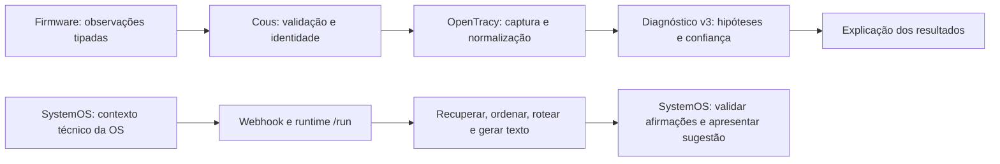

# Cognição no SystemOS, Cous e OpenTracy

Auditoria e primeira etapa de correção em 15/10/2026, horário de São Paulo. A inspeção incluiu o código do SystemOS no Windows e os projetos OpenTracy e Cous no Linux. **A infraestrutura responde, mas a integração atual do SystemOS ainda não implementa o ciclo cognitivo previsto para o Cous.** As correções desta etapa eliminam duas decisões indevidas de hipótese primária e tornam falhas de recuperação de conhecimento observáveis. Elas não certificam a qualidade do diagnóstico nem resolvem, por si, a redação do modelo.

## Arquitetura prevista e caminho observado

A referência principal é `OpenTracy/docs/INTEGRACAO_FIRMWARE_COUS_COGNICAO.md`, confrontada com o código, não tomada como prova de implementação. O Cous descreve sua divisão de responsabilidades em `README.md` e `docs/ARQUITETURA.md`.



A linha atual do SystemOS é a inferior. Estar conectado ao OpenTracy não implica utilizar seu motor de diagnóstico.

| Responsável | Contrato previsto | Situação encontrada |
| --- | --- | --- |
| Firmware | Medir, qualificar e publicar observações/correlações. | Fonte de medições, não redator de laudos. |
| Cous | Resolver equipamento/OS, normalizar evidências e vincular captura. | Clientes próprios de medições e diagnóstico v3 existem. |
| OpenTracy | Preservar captura, derivar assinatura, avaliar hipóteses e explicar resultados fundamentados. | Serviços de captura e diagnóstico disponíveis; cobertura de domínio ainda limitada. |
| SystemOS | Preservar fatos da OS e autoria, solicitar apoio, revisar e aplicar explicitamente. | Envia contexto técnico ao webhook; não foi encontrada ligação deste recurso com a fila v3. |
| Modelo de linguagem | Explicar resultados e registros, sem fabricar medições ou transformar possibilidade em constatação. | Houve respostas com unidades e afirmações incompatíveis com a OS, corretamente recusadas pela validação. |

Os clientes do Cous estão em `cous/clients/diagnosis.py` e `cous/clients/measurements.py`. Os contratos canônicos incluem `/measurements/sessions/{id}/snapshots`, `/v3/operational/resolve-capture`, `/measurements/sessions/{id}/capture-link` e `/v3/diagnosis`. A solicitação v3 exige `correlation_id`, `capture_session_id`, `instance_id`, `domain_id`, `callback_endpoint`, `priority`, `evidence_set` e `context`. Não se deve preencher essas identidades com UUIDs arbitrários apenas para satisfazer o esquema.

## Evidências da auditoria

| Verificação | Resultado observado | Limite da conclusão |
| --- | --- | --- |
| Diagnóstico v3 | Habilitado, banco configurado e worker em execução. | Disponibilidade não demonstra qualidade nem uso pelo SystemOS. |
| Capturas | Backend PostgreSQL e autenticação configurados. | Não demonstra vínculo correto de todas as OS atuais. |
| Base de conhecimento | 169 documentos e 676 trechos. | Quantidade não demonstra pertinência ou validação técnica. |
| Histórico de captura | 51 sessões de medição e 16 capturas. | Contagem do momento da auditoria, não contrato fixo. |
| Fila de diagnóstico | 33 concluídos; último enfileiramento observado em 28/09. | As análises atuais do SystemOS não aparecem como novos diagnósticos v3. |
| Conhecimento consolidado | 7 unidades ativas confirmadas; 6 ligadas a modos catalogados e uma unidade genérica de teste. | A unidade genérica é filtrada pelo worker; deve ser retirada da base operacional por procedimento separado. |
| Modos determinísticos | Rotor bloqueado, desacoplamento, sobrecarga nominal, sobretensão, interrupção e queda da fonte. | Não cobrem todo o domínio de reparação, contaminação ou danos de baterias. |
| Confiança | Combinação heurística de evidência, documentos, histórico e consistência. | Não é probabilidade de acerto calibrada em casos reais. |

A tabela `hypotheses` vazia não foi usada como prova de ausência de resultados: o worker também persiste resultados na fila. Dados privados, conteúdo integral das OS, credenciais e strings de conexão não fazem parte desta documentação.

### Geração de texto

Em `techniques/prompt_strategies/impl.py`, a variante direta seleciona constantes de prompt para SystemOS e para os demais pedidos. Nesse caminho, o prompt configurado em `agent/prompts/system.md` não é o que governa a chamada. Alterar somente esse Markdown pode não alterar o comportamento observado.

O caminho Ollama não executa o ciclo de ferramentas disponível no caminho OpenAI/DeepSeek. Descobrir ferramentas no código não significa fornecê-las ao modelo ou executar suas chamadas. A mensagem SystemOS também limita o material recuperado ao primeiro documento e a 600 caracteres. Esses pontos continuam pendentes.

O roteamento configurado usa `qwen3.5:4b` nos dois níveis, sem escalonamento em falha. O modelo roda no Windows, acessado pelo Linux através do túnel. Não foi substituído pelo modelo de 0,8b do Linux. `think: false` é a configuração observada; não foi alterada nesta etapa.

### Busca de conhecimento

O limite anterior era de cinco segundos. Uma consulta direta de domínio levou 13,07 segundos e retornou cinco documentos. O trace `386f2902-6e9d-469c-9f7d-477635c6f1f0` apresentou zero documentos na recuperação e no rerank; o log registrou timeout. A etapa devolvia lista vazia sem marcar erro no registro da etapa, confundindo indisponibilidade com ausência de resultados.

A consulta de verificação após a correção, usando os knobs do agente e sem chamar o modelo, recuperou **20 trechos em 11,04 segundos**. É uma amostra funcional; não representa latência máxima ou garantia de cobertura de todas as OS.

### Avaliações existentes

A suíte smoke encontrada era de atendimento de comércio eletrônico, com limite de quatro segundos. Foram encontrados 26 goldens na raiz; o caso de medição DKLAB não possui expectativas de conteúdo capazes de certificar uma conclusão técnica. Não há demonstração, nessa suíte, de calibração do diagnóstico de assistência técnica. Testes de infraestrutura e schema não substituem casos revisados por especialista.

## Correções implementadas nesta etapa

| Arquivo OpenTracy | Correção | Verificação |
| --- | --- | --- |
| `runtime/diagnosis/worker.py` | Não produzir hipótese sem evidência válida além do contexto administrativo; ignorar evidência marcada inválida. | Casos vazios, somente contexto, somente referência e somente conhecimento não geram diagnóstico. |
| `runtime/diagnosis/worker.py` | Aplicar `can_be_primary_hypothesis`, inclusive nos caminhos genérico e de telemetria. | Confianças 0,56 e 0,60 não são promovidas a hipótese primária; limiar comum é 0,61. |
| `runtime/diagnosis/worker.py` | Exigir presença de métricas observadas reconhecidas antes do fallback de telemetria. | Referências nominais isoladas não são apresentadas como funcionamento normal observado. |
| `techniques/rag/impl.py` e `agent/pipeline/retrieve.yaml` | Limite de busca de 45 segundos; estado explícito de recuperação. | Busca real concluída e testes de timeout/erro/resultado. |
| `runtime/executor/pipeline.py` | Copiar somente `status`, `reason` e `documents` da recuperação para `ExecutionRecord.metadata`. | Serialização preserva o estado sem copiar campos privados arbitrários do contexto. |
| Testes do worker, RAG e executor | Regressões para os casos acima. | 63 testes aprovados na seleção descrita abaixo. |

Antes da correção, a chamada sem evidências podia gerar “operação normal”, confiança 0,56 e `is_primary: true`. O caminho genérico também podia promover a primeira hipótese abaixo do limiar. Agora, ausência de observações não gera hipótese e candidatos fracos permanecem não primários.

**Limite ainda existente:** reconhecer a presença de um campo não equivale a qualificar a suficiência de uma coleta inteira. O fallback ainda pode produzir um candidato fraco de normalidade a partir de observações parciais. É necessário definir quais canais, qualidade e condições de ensaio sustentam cada conclusão. Zero medido, canal não medido e dado inválido precisam permanecer distintos.

A recuperação registra:

- `ok`: busca concluída com documentos;
- `empty`: busca concluída sem documentos;
- `unavailable` com motivo `not_configured`, `timeout` ou `search_error`.

A execução ainda pode continuar sem recuperação. Esta etapa não cria uma política de bloqueio automático da geração, nem muda `success` para falha quando apenas a busca falha. O diagnóstico de disponibilidade fica nos metadados; a API do gateway não ganhou um contrato novo de diagnóstico.

## Comportamento atual preservado no SystemOS

As funções ficam em `apps/api/src/assistente-ia/assistente-ia.service.ts`; o tipo de origem fica em `assistente-ia.types.ts`.

- O contexto técnico inclui componentes, testes de bancada, checklist, medições/correlações TDMA, serviços e metadados de anexos. Metadados não equivalem à leitura de fotografias ou PDFs.
- Nomes e contatos do cliente não são enviados; equipamento e série podem integrar o contexto técnico.
- A geração é assíncrona, com consulta de andamento, limite de 900 segundos e resultado temporário vinculado ao escopo de acesso.
- A validação rejeita afirmações sem apoio, incluindo números e unidades incompatíveis. Não foi afrouxada para fazer uma resposta ruim aparecer como válida.
- Quando toda a conclusão gerada é rejeitada, `textoBaseDosRegistros` compõe um texto com testes e análises registrados. Sua origem é `REGISTROS_OS`, distinta de `OPENTRACY`. Isso é contingência, não uma inferência bem-sucedida do modelo.
- `concluirComServicosSugeridos` acrescenta serviços já registrados, com confirmação de conformidade condicionada à execução e à verificação. Não deve afirmar que uma recomendação foi executada.
- A lista de IDs de evidência saiu da apresentação da conclusão; a rastreabilidade interna continua necessária.
- A sugestão não é aplicada automaticamente à OS. Rejeição parcial ainda exige revisão e pode deixar texto incompleto.

Esses comportamentos já existiam antes desta etapa. O commit de referência do SystemOS é `5b9f7d0`. Nenhum código de produto do SystemOS foi modificado nesta etapa de auditoria e documentação.

## Dimensionamento: contexto e tempo

16.384 tokens é o limite configurado de contexto, não uma medida de velocidade. Instruções, evidências recuperadas, conteúdo da OS e resposta precisam dividir esse orçamento; não se deve ocupar todo o limite com a entrada. O tamanho em bytes do JSON não é uma contagem exata de tokens.

Medições anteriores do mesmo ambiente, com aproximadamente seis mil tokens de entrada e algumas centenas de saída, levaram **8min29s e 9min19s**. São amostras históricas, não previsão por OS. A busca de 11 segundos não mede a geração. Particionar o conteúdo aumenta o número de chamadas e pode repetir processamento de contexto; não garante redução do tempo total.

Para dimensionar de modo reproduzível, registrar por fase: modelo/digest, configuração, tokens de entrada/saída, tempo de carga, avaliação de entrada, geração, busca, fila e duração total. Separar execução fria de quente e carga concorrente. Usar o tokenizer do modelo ou a contagem efetiva do servidor. Comparar um resumo tipado completo com lotes por subsistema e síntese final, sempre sobre os mesmos casos revisados. Não foram executados novos ensaios longos do modelo nesta etapa.

## Validação e ativação

No Linux, a partir do diretório do OpenTracy:

```bash
.venv/bin/python -m pytest runtime/tests/test_electromechanical_diagnosis.py runtime/tests/test_diagnosis_worker.py runtime/tests/test_cous_facts_tools.py knowledge/tests/test_causal_engine_modes.py techniques/rag/tests/test_dense.py runtime/tests/test_retrieval_observability.py runtime/tests/test_per_agent_executor.py -q
```

Resultado: **63 aprovados em 0,96 segundo**. São testes de lógica e infraestrutura, sem novas inferências do modelo e sem alterar uma OS real. A seleção inclui os casos novos e regressões do motor, ferramentas e cache do executor.

O runtime foi reiniciado de forma controlada: PID anterior conferido por diretório de trabalho e comando, encerramento por SIGTERM e início de uma única instância. Após a ativação: runtime `/health` respondeu `ok`, agente `v0.0.8`; gateway `/health` respondeu `ok`; diagnóstico v3 respondeu `available` com worker ativo. PID após a operação: `2646675` — valor histórico; não reutilizar em comandos sem verificar o processo atual.

A consulta real de busca passou com 20 trechos e `retrieval.status=ok`. Ela não gerou um novo diagnóstico nem uma nova conclusão. Gateway, banco, arquivos, túnel e Ollama não foram reiniciados. A versão nominal do agente não mudou; identificar esta correção pelo conjunto de arquivos/patch e pelos testes, não apenas por `v0.0.8`.

## Backup e reversão

Backup anterior às alterações desta etapa:

`/home/hiatus/.local/state/opentracy-systemos/backup-cognicao-20261015-232142`

O backup preserva as versões imediatamente anteriores, inclusive alterações locais que já existiam. `manifest.json` contém hashes SHA-256. O repositório Linux já tinha alterações não commitadas; não foi feito reset nem limpeza dessas alterações. O patch desta etapa deve ser comparado com esse backup, não com todo o diff do repositório.

Para reverter: verificar a identidade do runtime atual pelo PID registrado em `~/.local/state/opentracy-systemos/runtime.pid` e por `/proc/<pid>/cwd` e `/proc/<pid>/cmdline`; encerrar apenas esse runtime; validar os hashes do backup; restaurar os seis arquivos de código, testes e configuração existentes copiados no backup. O README também possui cópia anterior para reverter o link de documentação, se necessário. O teste novo `runtime/tests/test_retrieval_observability.py` não existia antes: removê-lo apenas se continuar sendo exatamente o arquivo introduzido por esta etapa. Não restaurar o repositório inteiro.

Reiniciar no diretório do OpenTracy com a mesma configuração de execução:

```bash
export OPENTRACY_OLLAMA_URL=http://127.0.0.1:11436
export OPENTRACY_OLLAMA_CONTEXT_WINDOW=16384
export OPENTRACY_OLLAMA_TIMEOUT_SECONDS=900
export OPENTRACY_OLLAMA_JSON=true
.venv/bin/python -m runtime.server
```

Manter esse terminal aberto se executado em primeiro plano. Para operação desacoplada, preservar o mecanismo gerenciado com PID e log; não iniciar uma segunda instância na porta ocupada. Verificar os mesmos endpoints de saúde. Não encerrar o túnel ou subir um Ollama diferente para contornar a falha.

## Próximas etapas e critérios de aceite

1. **Formalizar o adaptador SystemOS para o contrato existente.** Resolver identidades reais e vínculos organização/OS/equipamento/captura; normalizar evidências e unidades; vincular captura; solicitar diagnóstico v3. Definir autenticação, callback permitido, correlação, idempotência, repetição e consulta de estado. Não criar uma rota paralela que contorne essas etapas.
2. **Qualificar observações por hipótese.** Definir canais mínimos, qualidade, condições de operação e interpretação de zero/ausente/inválido. Recusar afirmação de normalidade quando a coleta não a sustenta.
3. **Separar diagnóstico de redação.** Fornecer ao modelo os fatos, hipóteses qualificadas e serviços propostos. Preservar limitações e incerteza; não permitir recalcular valores, inventar causalidade ou alterar a confiança formal.
4. **Corrigir o contrato efetivo de prompts e ferramentas.** Um caminho verificável para o prompt configurado e, se necessário, ciclo real de ferramentas somente leitura no provedor Ollama. Testar que o prompt e os resultados das ferramentas chegam ao modelo.
5. **Montar avaliações de domínio com revisão técnica.** Aprovar fixtures e conclusões esperadas antes de medir qualidade. Avaliar cobertura, contradições, causalidade indevida, unidades, completude, serviços sugeridos e abstenção; usar latência apenas junto da qualidade.
6. **Integrar e liberar com rastreabilidade.** Testar isolamento entre organizações, callback forjado, captura de outra OS, resposta atrasada, duplicidade, indisponibilidade e cancelamento. Só depois validar uma OS real em modo de sugestão, mantendo a decisão técnica humana.

| Caso de aceite | Resultado necessário | Estado nesta etapa |
| --- | --- | --- |
| Sem observações ou apenas contexto/referência | Nenhum diagnóstico de normalidade. | Automatizado. |
| Evidência inválida | Não sustenta hipótese. | Automatizado. |
| Confiança abaixo de 0,61 | Não primária. | Automatizado nos caminhos corrigidos. |
| Timeout de busca vs zero documentos | Estados distintos e preservados no trace. | Automatizado; busca real também verificada. |
| OS 1138: desacoplamento e inicial manual sem canais mensuráveis | Preservar limitação inicial; não inventar RPM/frequência; distinguir pós-reparo. | Precisa de fixture completa e validação técnica. |
| OS 1141: contaminação, películas, lubrificante e escovas | Cobrir fatos sem afirmar fratura ou dano funcional não constatado; separar possibilidade e constatação. | Precisa de fixture completa e validação técnica. |
| Serviços sugeridos | Baseados nos registros; não apresentados como executados. | Há montagem determinística no SystemOS; avaliar junto do novo diagnóstico. |
| Valor com unidade inventada | Rejeitar, sem flexibilizar a evidência. | Proteção existente no SystemOS; incluir na suíte integrada. |
| Callback/captura de outro escopo | Recusar sem alterar OS. | Integração canônica ainda pendente. |

## Fontes e artefatos

No Linux: projetos `/home/hiatus/Projetos/ligadotattoo/OpenTracy` e `/home/hiatus/Projetos/ligadotattoo/ligadoAi_cous_opentracy`. Fontes inspecionadas: documentos de arquitetura citados, `runtime/diagnosis/worker.py`, `knowledge/domain/confidence.py`, `techniques/rag/impl.py`, `techniques/prompt_strategies/impl.py`, `runtime/executor/pipeline.py`, configurações de pipeline e suítes de avaliação.

No SystemOS, `.runtime/auditoria-cognicao-linux/` conserva snapshots anteriores à correção, o reproducer e resultados da auditoria. Esses arquivos são privados e ignorados pelo Git. No Linux, `~/.local/state/opentracy-systemos/validacao-cognicao-20261015.json` registra a busca real; `runtime.log` e `runtime.pid` registram a instância gerenciada. O patch `correcao-cognicao.patch` e os hashes `arquivos-apos.json` desta etapa ficam ao lado do backup. Sua aplicação reversa foi conferida com `git apply --reverse --check`, sem modificar arquivos. O HEAD inspecionado do OpenTracy era `cb66c72`; as correções Linux permanecem no diretório de trabalho, preservadas pelo patch, sem misturar em um commit as alterações anteriores à auditoria. Não versionar logs integrais ou respostas com dados de clientes.

## Etapa 2 — identidade canônica e repetição de pedidos

Continuação em 15/10/2026. Implementação Linux commitada em `9e7c157` (`fix: validate scoped service orders and diagnosis request identity`). Não foram criadas rotas paralelas: os acréscimos estão em `/v3/operational/resolve-capture` e `/v3/diagnosis`.

### Contrato de vínculo com a OS

As duas solicitações aceitam `service_order_scope` opcional, com três campos obrigatórios quando o objeto está presente:

| Campo | Tipo e origem |
| --- | --- |
| `source_system` | Literal `systemos`. |
| `organization_id` | UUID real da organização autenticada no SystemOS. |
| `service_order_id` | UUID real da OS autorizada nessa organização. |

Objeto incompleto, UUID inválido, origem desconhecida e campos extras são recusados pelo schema. O adaptador futuro deve obter esses valores do contexto autorizado do servidor, não confiar em valores livres do navegador.

O resolver agora exige correspondência dos três campos em `knowledge_documents.metadata.extra`, além da OS, domínio e série. Quando o escopo é informado e não existe documento correspondente, ele não recua para uma busca apenas pelo número. Documentos excluídos também são ignorados. A série continua sendo conferida. O contrato sem escopo permanece aceito para compatibilidade com o Cous existente; isso não equivale a isolamento completo por organização no OpenTracy. O Bearer da aplicação continua sendo necessário quando configurado.

### Integridade e idempotência do diagnóstico

Antes de enfileirar, o endpoint verifica se a captura pertence à instância e ao domínio declarados. Se houver escopo, confere também se o documento de OS vinculado à captura corresponde aos três campos. Incompatibilidade retorna HTTP 409 sem inserir pedido.

A repetição de um `correlation_id` com a mesma solicitação devolve o estado e a data originais, inclusive quando o pedido já terminou. Não cria outro pedido nem o apresenta novamente como recém-enfileirado. Reutilizar o identificador com captura, contexto, evidências, callback ou outro campo diferente retorna 409. O resultado existente permanece intacto.

A resolução de identidade ainda cria um evento novo de captura por chamada. A integração SystemOS precisará persistir e reutilizar o vínculo antes de repetir a resolução; a idempotência da fila não elimina essa obrigação. O escopo conferido no documento também não substitui autorização do cliente integrador ou validação/autenticação do callback.

### Verificação desta etapa

Foram executados **85 testes, aprovados em 1,39 segundo**, reunindo a seleção anterior e os contratos novos. O teste PostgreSQL usa uma conexão dedicada, `search_path` restrito a `pg_temp` e tabelas temporárias. Não consulta nem altera registros de clientes para simular o fluxo.

O teste cria duas organizações com o mesmo número de OS e verifica: resolução do documento correto, recusa de organização/ID de OS/série divergentes, ausência de captura adicional nas recusas, recusa de captura/instância/domínio incorretos, recusa de documento excluído e repetição idempotente de diagnóstico. O teste HTTP também verifica o Bearer inválido e a rejeição de reutilização do identificador com conteúdo diferente.

Teste adicional: `runtime/tests/test_operational_scope_postgres.py`. Ele exige `OPENTRACY_RUN_DB_TESTS=1` e a configuração privada `OPENTRACY_KNOWLEDGE_DATABASE_URL`. Sem a opção explícita, é ignorado. A configuração privada foi carregada no processo de teste, sem imprimir seu conteúdo.

Após os testes, somente o runtime foi reiniciado. O OpenAPI carregado confirmou `service_order_scope` nos dois schemas. Runtime e gateway responderam `ok`, e o worker de diagnóstico respondeu `available`. PID observado após esta ativação: `2654330`; consultar e validar o PID atual antes de qualquer operação futura. A versão nominal permanece `v0.0.8`.

### Condição encontrada na base operacional

Consulta somente leitura: **85 documentos ativos de OS, nenhum com os três campos de escopo**. A busca pelo campo `metadata.extra.service_order_number` também não encontrou 1138 ou 1141. Isso não prova que não exista texto antigo dessas ordens em outro formato; prova que não há correspondência estruturada suficiente para ativar com segurança o novo caminho para elas.

Nenhum documento antigo foi associado automaticamente a uma organização e nenhum ID de captura foi inventado. O botão de análise do SystemOS continua no fluxo anterior. Esta etapa prepara e verifica o contrato canônico, mas **ainda não conecta a geração de conclusão ao diagnóstico v3** e não demonstra melhora da redação.

### Próximo incremento do adaptador

Implementar a publicação de um snapshot técnico identificado da OS pelo servidor do SystemOS, com autorização e revisão de escopo. A indexação deverá preservar `source_system`, `organization_id`, `service_order_id`, número da OS, série e versão/hash do snapshot. Reconciliar documentos antigos somente quando existir correspondência verificável; não presumir que número de OS identifica uma organização.

Em seguida, persistir a associação com os IDs retornados pelo resolver; importar/vincular apenas medições realmente existentes, com suas condições e qualidade; solicitar diagnóstico com correlação persistida; consultar/receber resultado verificando novamente a captura e o escopo. Só depois usar esse resultado e os registros técnicos como entrada da redação. O fluxo antigo não deve ser desativado antes dessa verificação de ponta a ponta.

### Preservação e reversão

Backup desta etapa: `/home/hiatus/.local/state/opentracy-systemos/backup-identidade-20261015-233809`. Contém os seis arquivos preexistentes, `manifest.json`, `identidade-escopo.patch` e `arquivos-apos.json`. O sétimo arquivo é o teste PostgreSQL novo. Antes de editar, foi conferido que os seis arquivos eram iguais ao HEAD; o commit não incluiu alterações anteriores de outros arquivos do Linux.

A reversão do patch passou em `git apply --reverse --check`. Para executar uma reversão futura, conferir novamente essa checagem no diretório do OpenTracy e a identidade do runtime, interromper somente esse processo, aplicar a reversão apenas se a checagem continuar válida e reiniciar com a configuração preservada. Não usar reset do repositório. Gateway, túnel, Ollama e dados operacionais permanecem preservados. A reversão não exige migração de banco: os acréscimos usam metadados e colunas já existentes.
